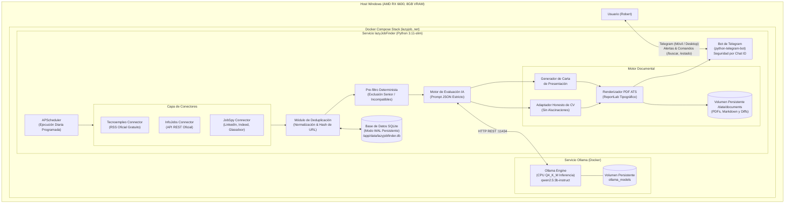

# Arquitectura del Sistema: lazyJobFinder

Este documento describe la arquitectura, los componentes, los flujos de datos y las garantías de diseño de **lazyJobFinder**, el sistema autónomo y local de búsqueda, filtrado, evaluación y adaptación de candidaturas de empleo para perfiles junior de desarrollo de software (DAM).

---

## 1. Diagrama de Arquitectura Global



---

## 2. Componentes y Responsabilidades

### A. Capa de Descubrimiento y Conectores (`src/connectors/`)
- **`BaseConnector`**: Interfaz abstracta que define el contrato común (`search(terms, locations, hours_old) -> List[JobOffer]`).
- **`TecnoempleoConnector`**: Lee canales RSS públicos de Tecnoempleo filtrando por tecnologías (Java, Junior, Full Stack, DAM). Cero credenciales requeridas, fiabilidad del 100%.
- **`InfoJobsConnector`**: Consume la API oficial de InfoJobs (`/api/9/offer`) si existen credenciales en variables de entorno. Transforma la respuesta en objetos normalizados `JobOffer`.
- **`JobSpyConnector`**: Agrega ofertas de Indeed España, LinkedIn España, Glassdoor y Google Jobs, normalizando títulos, descripciones, modalidades (remoto/híbrido) y salarios.
- **`ConnectorManager`**: Orquesta la ejecución secuencial o concurrente controlada con retardos anti-saturación, capturando fallos puntuales de red sin detener las demás fuentes.

### B. Deduplicación y Persistencia (`src/database.py`)
- Base de datos relacional local **SQLite** con registro **WAL (Write-Ahead Logging)** para máxima concurrencia y tolerancia a cortes de energía.
- Algoritmo de deduplicación:
  1. Limpieza de URLs (eliminación de parámetros de rastreo: `utm_*`, `ref`, `trackingId`, etc.).
  2. Generación de clave única `sha256(canonical_url)` y clave secundaria `sha256(clean_title + clean_company)`.
  3. Si la oferta ya existe y no ha cambiado sustancialmente, se descarta para evitar notificaciones repetidas.

### C. Pre-Filtro Determinista (`src/evaluator/scoring_engine.py`)
Antes de invocar el modelo de lenguaje en CPU:
- Descarta automáticamente puestos con palabras de exclusión: `Senior`, `Lead`, `Principal`, `Architect`, `5+ años`, `10+ años`, `Jefe de proyecto`.
- Verifica que el puesto contenga al menos una tecnología o competencia del currículum DAM (Java, SQL, JavaScript, PHP, Spring, HTML/CSS, etc.).
- **Beneficio**: Ahorra más del 70% del tiempo de cómputo de la máquina, reservando la inferencia IA únicamente para las ofertas con potencial real.

### D. Motor de Evaluación IA y Política Anti-Alucinación (`src/evaluator/`)
- Se conecta a Ollama mediante HTTP REST nativo (`http://ollama:11434/api/generate`).
- Inyecta el perfil verídico del candidato (`config/profile.yaml`) y la descripción completa de la oferta.
- **Garantías Anti-Alucinación**:
  - El prompt del sistema prohíbe explícitamente agregar experiencia no documentada, modificar fechas, inventar empresas o declarar dominio de tecnologías ausentes en `profile.yaml`.
  - El modelo debe devolver una estructura JSON estricta con:
    ```json
    {
      "score": 85,
      "fit_level": "EXCELENTE",
      "verdict": "Encaje alto para puesto junior con Java y SQL.",
      "matched_skills": ["Java", "SQL", "Git", "DAM"],
      "missing_skills": ["Docker en producción", "Kubernetes"],
      "strengths": ["Sólida base en Java y POO del ciclo DAM."],
      "gaps": ["Piden nociones de Kubernetes que no constan en el perfil."],
      "should_apply": true
    }
    ```

### E. Motor Documental (`src/tailoring/`)
- Si `score >= MIN_SCORE_THRESHOLD` (por defecto 65/100):
  1. **Adaptación honesta del CV**:
     - Conserva los datos fácticos inalterados (educación, empresas reales, proyectos reales).
     - Adapta el resumen profesional inicial (`summary`) para destacar las tecnologías reales del candidato que mejor encajan con la vacante.
     - Reordena los proyectos formativos para poner en primer plano aquellos que utilizan el stack pedido en la oferta (por ejemplo, destacando el proyecto Java/Spring Boot si la oferta es de backend Java).
     - Genera un archivo de auditoría `cambios_cv.json` explicando con total transparencia cada cambio de énfasis.
  2. **Carta de presentación personalizada**:
     - Redacta una carta concisa (3-4 párrafos), formal y profesional en español, explicando por qué la formación en DAM y los proyectos realizados aportan valor al puesto, reconociendo con naturalidad las tecnologías en las que se está dispuesto a aprender.
  3. **Compilación PDF con ReportLab**:
     - Genera dos archivos PDF limpios, con márgenes estándar y tipografía estructurada (legibles por ATS y humanos).
     - Los almacena organizados en `/app/data/documents/{job_id}_{empresa}/`.

### F. Interfaz Principal: Bot de Telegram (`src/telegram_bot/`)
- Utiliza la librería oficial `python-telegram-bot` en modo Long-Polling (sin necesidad de abrir puertos públicos ni configurar certificados SSL/webhook).
- **Control de Acceso Estricto**:
  - Filtro a nivel de middleware que valida `update.effective_user.id == TELEGRAM_ALLOWED_USER_ID`.
  - Cualquier mensaje de otro usuario es rechazado y registrado en el log de auditoría.
- **Notificaciones del Planificador Diario**:
  - Envía un mensaje con formato enriquecido (MarkdownV2 / HTML) con el resumen de las ofertas del día:
    - 🏢 Empresa y Puesto.
    - 📍 Ubicación y Modalidad (Presencial / Híbrido / Remoto).
    - 🎯 Puntuación de afinidad (ej. 85/100) y veredicto.
    - ✅ Requisitos cumplidos.
    - ⚠️ Requisitos que faltan.
    - 🔗 Enlace directo a la oferta original.
  - Adjunta de inmediato el **CV adaptado en PDF** y la **Carta de presentación en PDF**.
- **Comandos Interactivos**:
  - `/buscar`: Ejecuta una búsqueda y evaluación manual bajo demanda.
  - `/estado`: Reporta el estado de salud de Ollama, el modelo cargado, la base de datos y la última ejecución.
  - `/ultimas`: Muestra las mejores ofertas detectadas recientemente.
  - `/ayuda`: Guía de comandos disponibles.

### G. Interfaz de Administración Web SPA (`web/` y `src/api/`)
- **Backend FastAPI (`127.0.0.1:8000`)**:
  - Rutas REST modulares vinculadas a localhost para seguridad y privacidad total.
  - Streaming en tiempo real vía **Server-Sent Events (SSE)** en `/api/system/logs/stream`.
  - Control de Docker con lista blanca estricta de servicios y acciones permitidas.
  - Extracción y previsualización de CVs vía `/api/cv/preview`.
- **Frontend SPA Next.js 14 (`web/`)**:
  - **Sin panel lateral ni recargas**: Barra de navegación superior fija con cambio instantáneo entre pestañas (0 ms) preservando el estado en memoria.
  - **CSS 100% Relativo**: Layout fluido con `rem`, `%`, `flex`, `grid` adaptable y `dvh`, garantizando total responsividad sin anchos fijos.
  - Pestañas modulares: Candidaturas, Búsqueda y CV, Servicios/Logs y Configuración.

### H. Extractor de CV y Lectura Multiformato (`src/tailoring/cv_reader.py`)
- Extracción de texto plano de documentos `.pdf`, `.md`, `.markdown` y `.txt` hasta 5 MB.
- Para PDFs: motor `pypdf` con fallback algorítmico por expresiones regulares sobre streams internos de texto.
- Previsualizador interactivo en la interfaz para contrastar qué lee la IA antes del escaneo.

### I. Lanzador Unificado y Orquestador de Arranque (`start.bat`)
- Búsqueda dinámica de la ruta del ejecutable de Docker Desktop en el sistema operativo.
- Bucle de espera activa con reintentos para el motor de Docker antes de levantar los contenedores.
- Sondeo continuo de la salud del backend (`/api/health`) antes de abrir el navegador o arrancar Next.js, evitando errores de conexión (`ECONNREFUSED`).
- Soporte para menú interactivo (`choice`) y flags CLI directos (`--all`, `--docker`, `--web`, `--status`, `--pull`, `--stop`).

### J. Contrato de Datos Compartido y Esquema SQL Unificado
- **`config/shared_constants.json`**: Fuente única de verdad para estados, portales, acciones y límites.
- Vinculaciones generadas en [`src/shared_constants.py`](../src/shared_constants.py) y [`web/src/lib/constants.ts`](../web/src/lib/constants.ts).
- Esquema relacional canónico consolidado en [`src/migrations/sql/schema.sql`](../src/migrations/sql/schema.sql).
