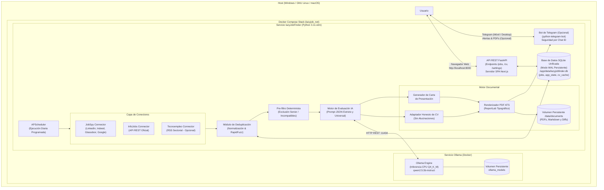

# Arquitectura del Sistema: lazyJobFinder

Este documento describe la arquitectura, los componentes, los flujos de datos y las garantías de diseño de **lazyJobFinder**, el sistema autónomo y local de búsqueda, filtrado, evaluación y adaptación de candidaturas de empleo para **cualquier perfil profesional** en España.

---

## 1. Diagrama de Arquitectura Global



---

## 2. Componentes y Responsabilidades

### A. Capa de Descubrimiento y Conectores (`src/connectors/`)
- **`BaseConnector`**: Interfaz abstracta que define el contrato común (`search(terms, locations, hours_old) -> List[JobOffer]`).
- **`JobSpyConnector`**: Agregador primario multi-portal (Indeed España, LinkedIn España, Glassdoor y Google Jobs), normalizando títulos, descripciones, modalidades (remoto/híbrido/presencial) y salarios para cualquier disciplina laboral.
- **`InfoJobsConnector`**: Consume la API oficial de InfoJobs (`/api/9/offer`) si existen credenciales opcionales en variables de entorno.
- **`TecnoempleoConnector`**: Lector de canales RSS públicos de Tecnoempleo. Portal vertical tecnológico que permanece desactivado por defecto para no contaminar búsquedas generales de otros sectores.
- **`ConnectorManager`**: Orquesta la ejecución secuencial o concurrente controlada con retardos anti-saturación, capturando fallos puntuales de red sin detener las demás fuentes.

### B. Deduplicación y Persistencia SQLite (`src/database.py` y `src/models.py`)
- **Fuente Única de Verdad (`src/models.py`)**: Modelos canónicos tipados con **Pydantic V2** (`JobModel`, `EvaluationModel`, `GeneratedDocumentModel`, `PipelineRunModel`, `SystemLogModel`, `AppStateModel`, `CVCacheModel`). Cualquier adición de campo se propaga automáticamente a la API FastAPI, a las conversiones JSON y a las tablas SQLite sin código redundante.
- **Auto-migración y Utilidades de Alto Rendimiento con `sqlite-utils`**:
  - Auto-migración en caliente (`alter=True`) que incorpora nuevas columnas a las tablas dinámicamente sin necesidad de scripts manuales de `ALTER TABLE`.
  - Motor de búsqueda **FTS5** (`jobs_fts`) para búsquedas textuales instantáneas en tiempo real sobre títulos, empresas y descripciones.
  - Inserciones masivas por lotes (`upsert_all`) en una única transacción atómica de milisegundos.
- **Base de datos relacional local SQLite** (`data/lazyjobfinder.db`):
  - Modo `TRUNCATE` / `WAL` optimizado para máxima compatibilidad y cero bloqueos de memoria compartida bajo Docker y sistemas de archivos montados (WSL2 / Windows).
  - **Optimizaciones de Memoria**: `PRAGMA cache_size = -64000` (~64 MB de caché en RAM) y `PRAGMA temp_store = MEMORY` para que las agregaciones de facetas y ordenaciones se resuelvan en memoria.
  - **Blindaje de Concurrencia**: `PRAGMA busy_timeout = 30000` con reintentos exponenciales automáticos ante bloqueos de escritura.
- **Tablas Consolidadas**:
  - `jobs`: Ofertas indexadas con deduplicación por `url_hash` y similitud difusa `content_fingerprint` con RapidFuzz.
  - `evaluations`: Evaluaciones ATS de IA y análisis estructurado con unicidad en `job_id`.
  - `generated_documents`: Rutas auditadas de CVs y cartas adaptadas en PDF y Markdown.
  - `app_state`: Ajustes globales y puntero atómico al CV activo.
  - `cv_cache`: Caché centralizada del texto extraído de cada currículum subido (evita re-parseos y previene archivos temporales en disco).
  - `pipeline_runs` y `system_logs`: Auditoría, control de días omitidos por apagado y registro de eventos.

### C. Pre-Filtro Determinista (`src/evaluator/scoring_engine.py`)
Antes de invocar el modelo de lenguaje en CPU:
- Descarta automáticamente puestos con palabras de exclusión explícitas incompatibles con el nivel del candidato (ej. `Senior`, `Lead`, `Principal`, `Director`, `5+ años de experiencia`).
- Verifica la presencia de términos básicos del perfil o capacitación acreditada.
- **Beneficio**: Ahorra más del 70% del tiempo de cómputo de la máquina, reservando la inferencia IA únicamente para las ofertas con potencial real.

### D. Motor de Evaluación IA y Política Anti-Alucinación (`src/evaluator/`)
- Se conecta a Ollama mediante HTTP REST nativo (`http://ollama:11434/api/generate`).
- Inyecta el texto real y verificado del CV activo y la descripción completa de la vacante.
- **Garantías Anti-Alucinación**:
  - El prompt del sistema prohíbe explícitamente agregar experiencia no documentada, modificar fechas, inventar empresas o declarar competencias ausentes en el CV.
  - El modelo devuelve una estructura JSON estricta y universal:
    ```json
    {
      "score": 85,
      "fit_level": "ALTO",
      "verdict": "Cumple los requisitos principales del puesto con experiencia contrastada.",
      "matched_skills": ["Gestión de inventarios", "Manejo de carretilla elevadora"],
      "missing_skills": ["Certificado ADR mercancías peligrosas"],
      "strengths": ["Amplia experiencia en almacén y logística."],
      "gaps": ["Requieren carné ADR no acreditado en el currículum."],
      "should_apply": true
    }
    ```

### E. Motor Documental (`src/tailoring/`)
- Si `score >= MIN_SCORE_THRESHOLD` (por defecto 65/100):
  1. **Adaptación honesta del CV**:
     - Conserva todos los datos fácticos inalterados (educación, empresas reales, años de servicio).
     - Adapta el resumen profesional inicial (`summary`) para destacar los puntos fuertes que mejor encajan con la vacante.
     - Genera un archivo de auditoría `cambios_cv.json` explicando con total transparencia cada énfasis.
  2. **Carta de presentación personalizada**:
     - Redacta una carta formal y profesional en español adaptada al puesto, destacando por qué la experiencia del candidato aporta valor y reconociendo con naturalidad áreas de aprendizaje.
  3. **Compilación PDF con ReportLab**:
     - Genera dos archivos PDF limpios y estructurados, optimizados tanto para lectura humana como para filtros ATS.
     - Los almacena organizados en `/app/data/documents/{job_id}_{empresa}/`.

### F. Interfaz de Administración Web SPA (`web/` y `src/api/`)
- **Backend FastAPI (`127.0.0.1:8000`)**:
  - Rutas REST modulares vinculadas a localhost para máxima seguridad y privacidad.
  - Streaming en tiempo real vía **Server-Sent Events (SSE)** en `/api/system/logs/stream`.
  - Control de Docker con lista blanca estricta de servicios y acciones permitidas.
  - Extracción y previsualización de CVs vía `/api/cv/preview`.
- **Frontend SPA Next.js 14 (`web/`)**:
  - Compilado a estáticos (`output: 'export'`) servidos por FastAPI (cero dependencias de Node.js en producción).
  - Barra de control de CV compacta e integrada en una sola línea en la cabecera.
  - Vaciado de historial rápido con modal directo de confirmación.
  - Diseño 100% fluido y relativo con Tailwind CSS.

### G. Bot de Telegram (Opcional - `src/telegram_bot/`)
- Comunicación desacoplada mediante `python-telegram-bot` en Long-Polling.
- Notificaciones del resumen diario de ofertas con los documentos PDF adjuntos.
- Comandos interactivos: `/buscar`, `/estado`, `/ultimas`, `/ayuda`.

### H. Empaquetado y Distribución (`packaging/` y `dist/`)
- Suite de distribución multiplataforma orquestada por [`packaging/build_release.py`](../packaging/build_release.py).
- Genera ejecutables e instaladores autónomos en la carpeta [`dist/`](../dist):
  - **Windows:** Instalador guiado Inno Setup (`.exe`) y paquete portable (`.zip`) con `install.bat`.
  - **GNU/Linux:** Autoextraíble binario (`.run`) y tarball (`.tar.gz`) con `installer.sh`.
  - Auditoría de seguridad previa bloqueante que garantiza que no se empaquetan credenciales, datos personales ni historiales previos.

